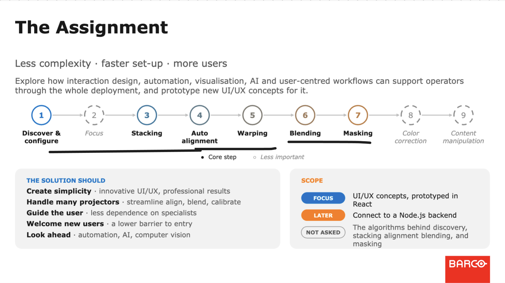
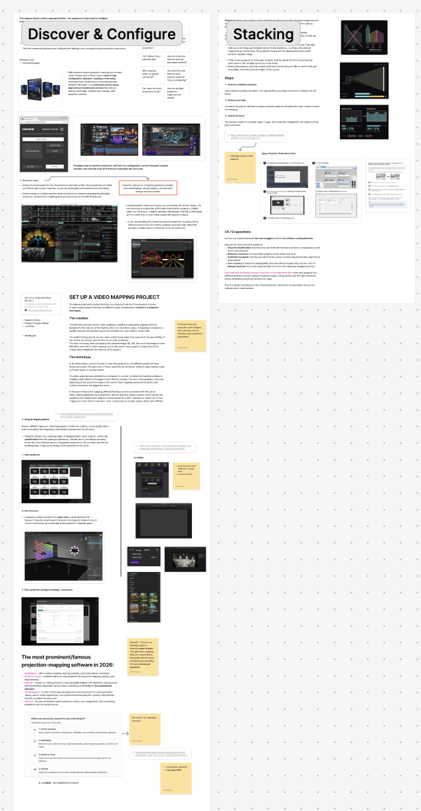
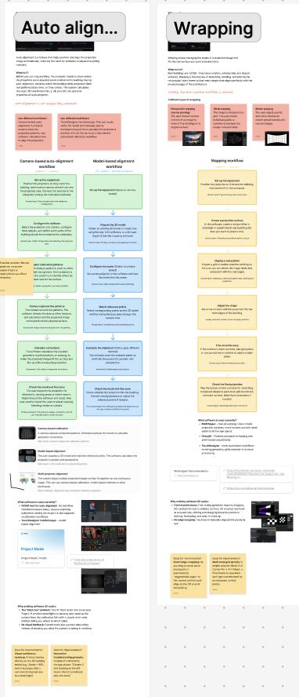
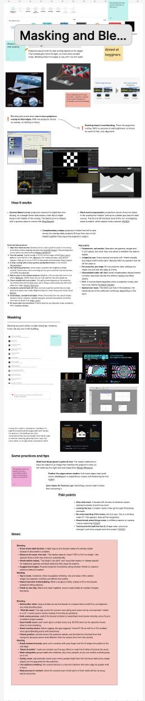
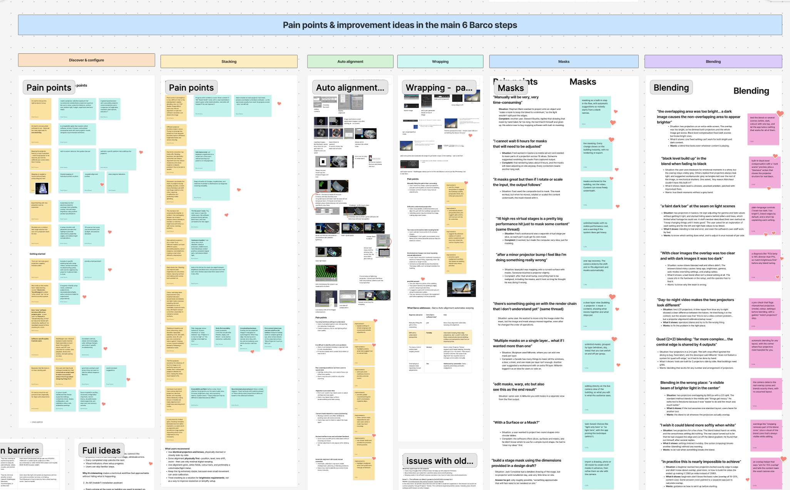
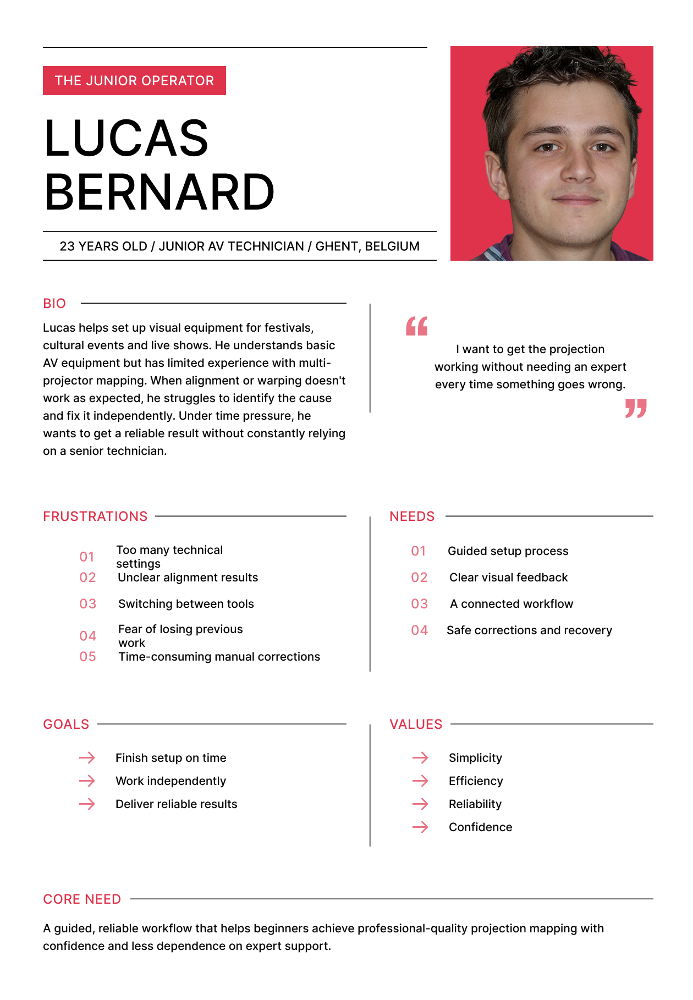
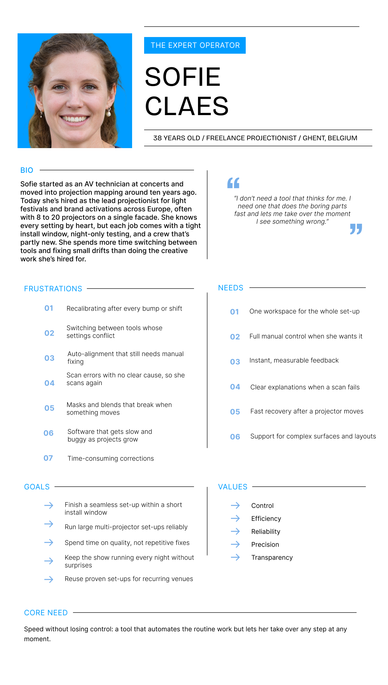

**Our client**

Barco

**The briefing**

"Explore, design and prototype innovative UX/UI concepts that make the set-up and operation of video mapping events – from a projector perspective – simpler, faster and accessible to a broader range of users, from expert projectionists to less experienced operators."

**First steps**

Once my team and I received the briefing by our client, Barco, we started off by researching each step of the projection mapping journey set by Barco (discover & configure, stacking, auto alignment, blending and masking).

We split up the research and devided the steps equally per person - each person had to research two steps of the projection mapping workflow (without the grayed out ones), since we weren't too familiar with the specifics of projection mapping. We ended up discussing each step together and sharing information so we were all on board with the workflow, and how each steps work. We kept track of our research on Figjam:

After we discussed every step of the workflow, we researched the different pain poins users find in every step, once again splitting the 6 main steps (Discover & Configure, Stacking, Auto alignment, Wrapping, Masking and Blending) between all three of us. For our research we mostly relied on online discussions, opinions and reviews, as well as group analysis of different famous projection mapping softwares such as MadMapper, Resolume, HeavyM and others. We also tried to brainstorm early options for features that would help us improve the interface in a way that would handle the pain points we found.

Based on the pain points, Liviu and Ulrika came up with target personas for an inexperienced user ("The junior operator") and an expert user ("The expert operator").

After that we delved deeper into brainstorming together possible concept ideas for our pitch deck. At last, we ended up with 6 main UX ideas:

**1. Turn complex technical challenges into clear, intuitive UI.**

Use plain language, clear labels, recommended defaults and contextual explanations so users understand what settings do and when to change them.

**2. Allow users to test steps virtually on surface.**

Use visual feedback directly on the projection preview to check for alignment issues, masking boundaries or other issues before testing on real buildings or surfaces.

**3. Offer progressive enhancement and support.**

Provide a clear starting point, step-by-step guidance and relevant suggestions when problems occur. Let experienced users skip familiar steps and access advanced controls.

**4. Catch and communicate  risks and errors to the user before they happen.**

Highlight potential obstructions, check relevant setup conditions and identify possible risks before the final projection. Where prediction is uncertain, clearly communicate that to the user.

**5. Ensure easy recovery through version history.**
Provide undo and recovery options, save useful configuration versions and make it easy to compare changes or return to a working setup.

**6. Connect the whole workflow into one interface.**

Keep setup, alignment, warping, masking, blending and troubleshooting connected. Help users understand how a change in one part may affect the rest of the installation.

We ended up using these principles as the foundation of our client pitch-deck we submitted on 30/10.

**Usage of AI**

So far we've used AI to brainstorm, learn information about project mapping, find resources and generate quick sketches when needed. We use chatGPT, Claude, Gemini and Perplexity.
