## Client meeting - and feedback

On 02/11 (Monday) we had an online meeting with our Barco representative, and we went over their software and certain specifics of what they expect from us. It was very helpful and we received some guidance on how to proceed further, and what to focus on. Overall, we received feedback that our concept was still too focused on UX principles and lacked an actual narrow definition and focus, so my team and I decided to do more brainstorms on the research question "How might we make multi-projector setups faster, safer and easier to understand for both inexperienced users and specialists?", with the hopes of coming up with a more concrete concept.

These were our brainstorms:

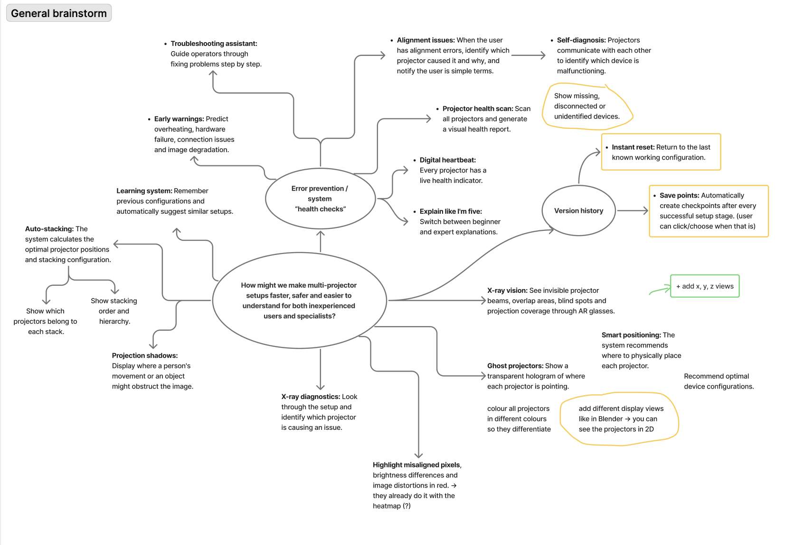

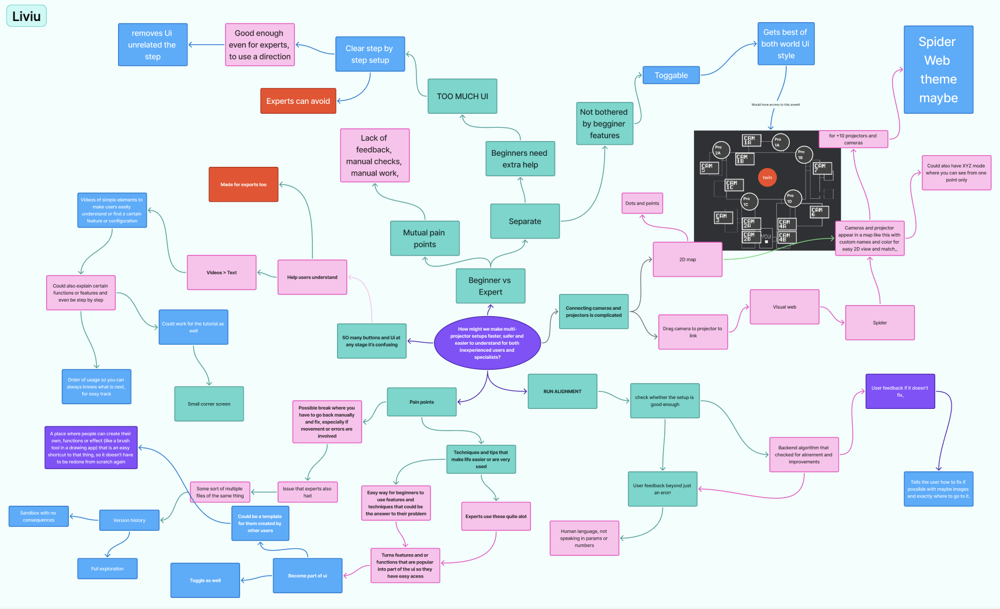

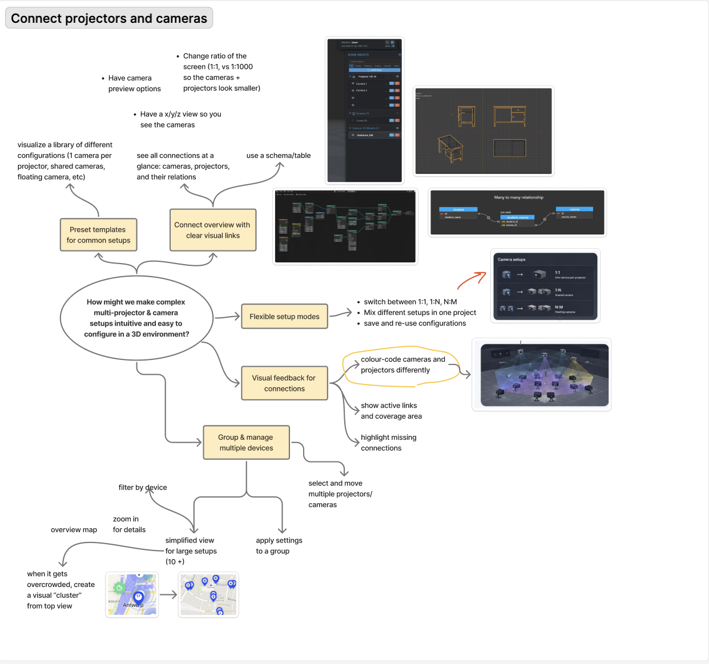

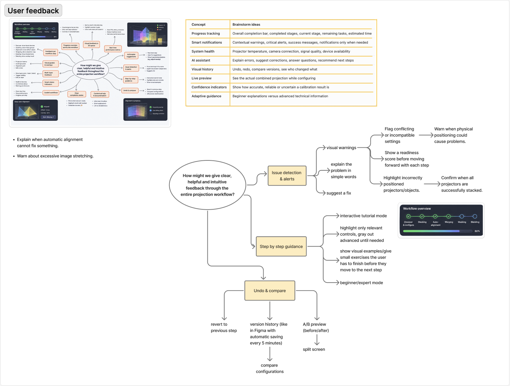

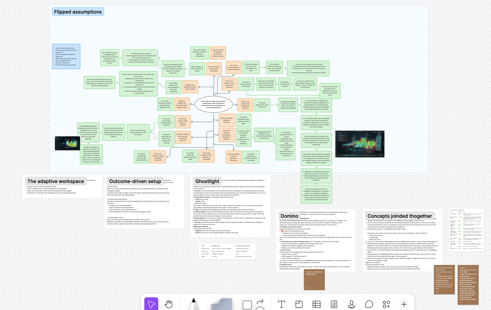

We used AI (mostly Claude) to generate very early sketches of the interface, just to help us have a visual guide for certain ideas:

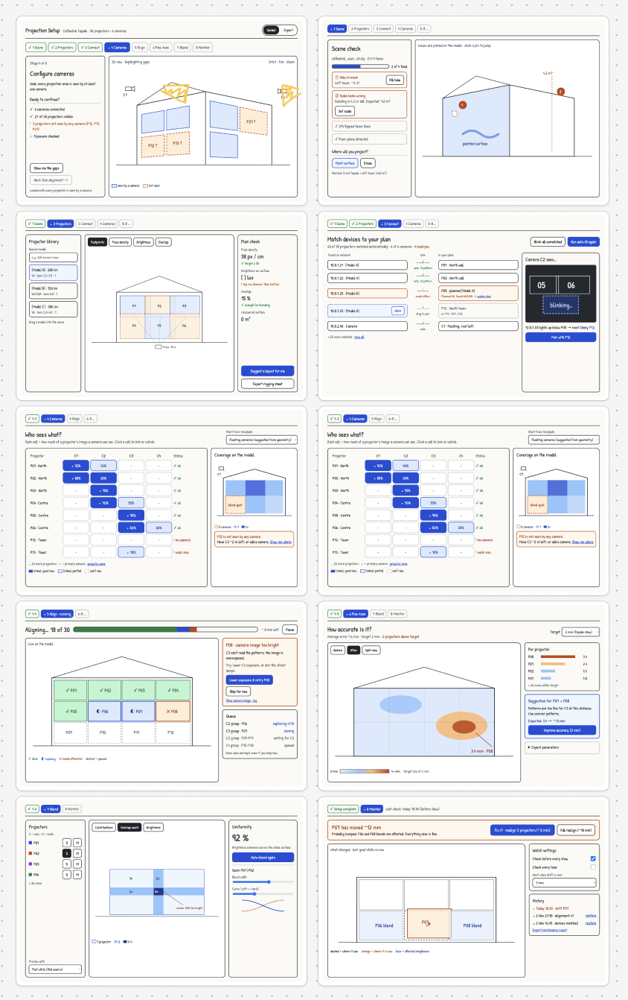

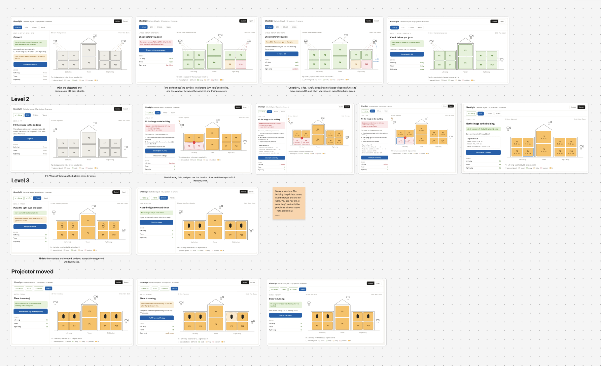

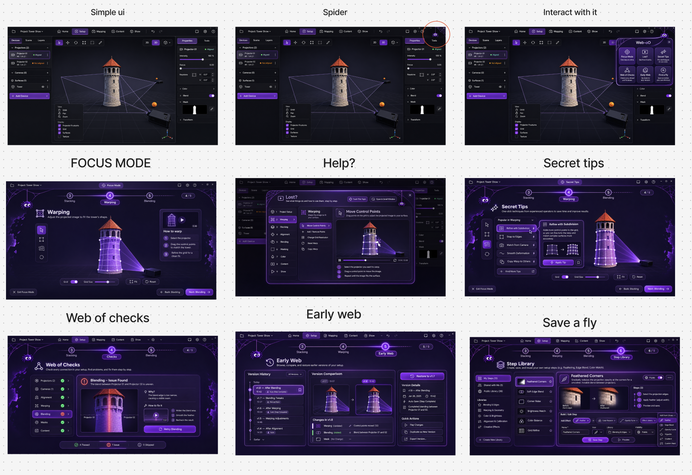

When we got together to discuss all the ideas we came up with during the brainstorms, we came up with a more defined concept, and we wrote it down.

## New concept

# Web-oO

## The issue

A video mapping show needs up to 30–50 projectors and several cameras working as one canvas. Today, setting that up means many separate technical steps, settings only experts understand, and errors nobody can explain.

Beginners get stuck, and experts lose time fixing the same things over and over.

## The concept

Web-oO is a companion tool that lives in the corner of Barco’s projection mapping setup software. It appears as a small spider hanging at the edge of the screen. It never pops up uninvited: pull it down by its thread and it drops a toolbar with six tools; push it back up and it’s gone.

Beginners keep it close, and experts call it only when they need it.

Web-oO isn’t tied to one part of the software. The software keeps its own interface for each section of the setup:

- Discover & configure
- Focus
- Stacking
- Auto alignment
- Warping
- Blending
- Masking
- Colour correction
- Content manipulation

Web-oO works across all of them. Its six tools are general:

1. Guidance
2. Help
3. Shortcuts
4. Error checks
5. Version history
6. Custom techniques

Each tool adapts to whichever section you’re working in, so the same tool helps you whether you’re aligning, blending or masking.

### The web metaphor

Web-oO sees the setup as a web: projectors, cameras and the building, connected by threads.

- A projector is a node.
- A camera that sees a projector is a thread.
- A seam between two projectors is a thread.
- A mask is a cut in the web.

You build that web step by step, from the first projector to the final show. When every thread is complete and healthy, the show is ready. When a thread breaks, Web-oO shows you exactly where.

---

## The six tools

The tools are built to stack: each one works on its own, but they also work together. Each tool answers common pain points, helping beginners and experts alike.

### 1. Continuous Web

The screen rebuilds itself around one step at a time. The setup is split into its separate steps, and each step shows only the tools and the part of the web it needs.

- You start from whichever step you choose and can jump to any other step at any time.
- UI that isn’t relevant to the current step is hidden.
- In the settings, users can choose which buttons from other steps stay visible.

**For experts:** A cleaner interface and a clear view of which step they’re in.

### 2. Lost?

Explains what a button does or how to do something, with a short animation of the process. The explanations are written so anyone can follow them, in logical steps, so they work in a small window without opening a big screen again.

- The first column lists the sections; the user picks one.
- The second column shows the buttons and features of that section.
- A simple animated example shows the process.
- Short numbered instructions in plain language explain it.
- A button turns it into a small window that follows you step by step, so you always know where you are and what’s next.

**For experts:** They can turn it off completely or use it only for features they rarely touch.

### 3. Webs of a Web

The techniques experienced operators use most, like feathering a mask edge or linking blend edges, are turned into one-click shortcuts that appear as part of the UI.

The techniques come from research and forums, and users can upload their own as templates for others.

- The 10 most popular techniques are added to the UI the first time you open it.
- Hovering over a technique explains what it does.
- A small bar lets you adjust each technique.
- A library holds public techniques that users can add, favourite and rate.
- Ratings show which techniques work well.
- Your saved and favourited techniques gradually replace the most popular ones, based on what you actually use.

**For experts:** Quick access to the shortcuts they use most, plus their own techniques through Find a Fly in the Web (tool 6).

### 4. No Thread Broken

Monitors the health of every thread. Instead of showing "alignment failed", it shows which thread broke, why (stray light, a blocked camera, a dim lamp), and how to fix it, with a short video where useful.

Then you retry only that part.

- Select what you want checked and press the button.
- The system scans it and tells you what has errors, why, and how to fix them.
- When the system isn’t sure about a result, it says so.
- Paired with Continuous Web, it can scan a whole step at once.
- It can run in a small window and warn you about errors as they appear.
- During the show, it keeps watching the web and warns when a thread breaks, for example when a projector drifts or a lamp dims.

**For experts:** Fix mistakes on the spot, without going back through the whole setup. They can also open the technical parameters behind each check, such as pattern size and projector brightness, which stay hidden for beginners.

### 5. Making of the Web

Every version of the web is saved automatically every few minutes and at risky moments, like before alignment. You can compare versions and go back to any earlier state in one step.

This gives users the freedom to make mistakes without fear of losing work.

- Each version notes what changed, written by you or, if you don’t, by the system.
- Restore the whole web or only one part of it, such as a single projector, seam or mask.

### 6. Find a Fly in the Web

When a user creates an effect, setting or feature, they can press the + button to turn it into their own shortcut, like a custom brush in a drawing app or a material in Blender.

Shortcuts can be shared, and popular ones can become part of Secret Tips.

- A screen opens where you record the steps that create the result.
- Save it with a name, a custom icon and an optional description.
- Open it later from your saved shortcuts.

**For experts:** Create and save their own techniques once, so they never repeat the same steps for the same result, and use methods made by others.

Then, Liviu made some sketches to illustrate our concept idea:

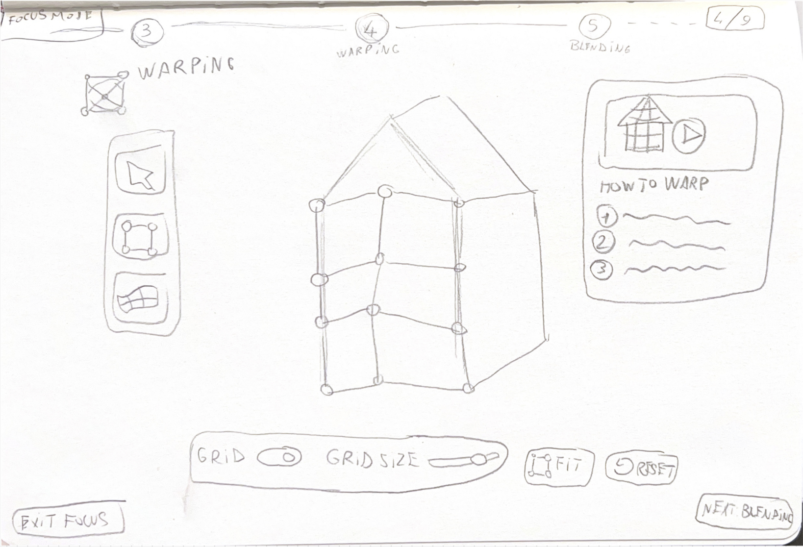
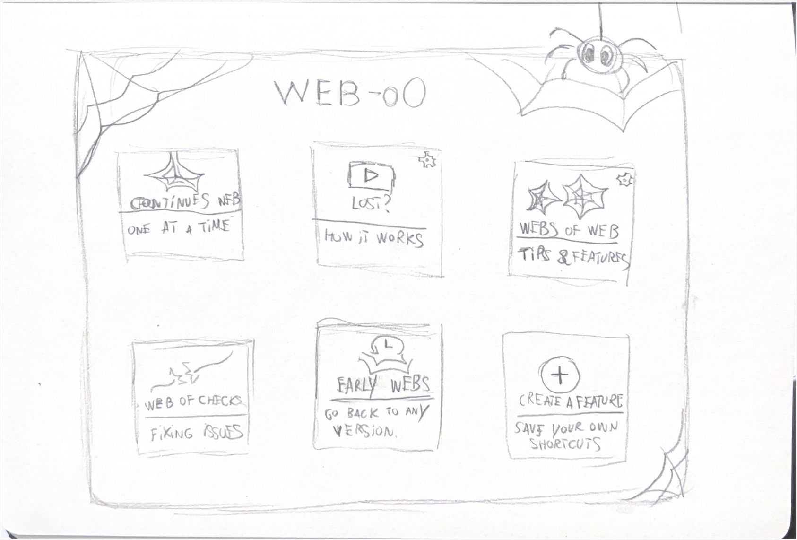
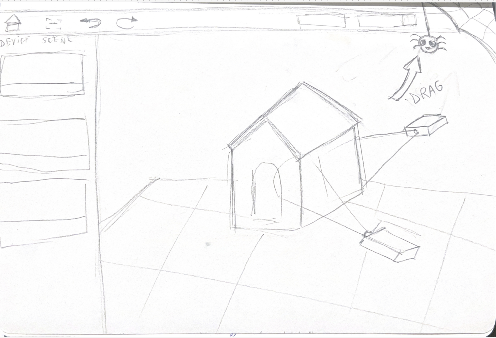

Finally, we sent a document explaining our concept to the client for feedback.
