## Competitor analysis

On Monday and Tuesday (09/11 - 10/11) we mainly worked on conducting comparison research of the top 11 most popular softwares in the project mapping industry. We devided the work - 3/4/4 softwares per person. Here we will present our findings in a list:

### 1. Lazy Lighting

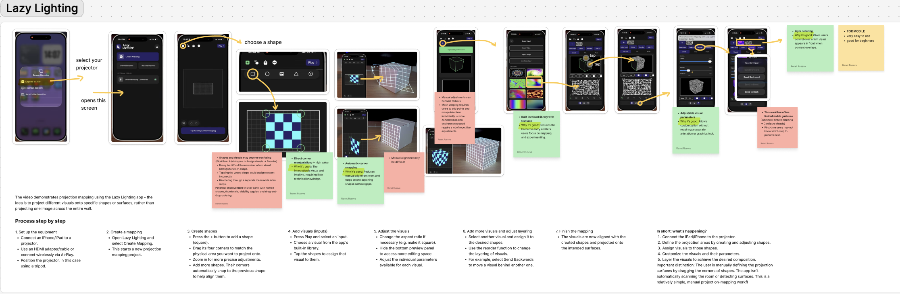

### 2. Mad Mapper

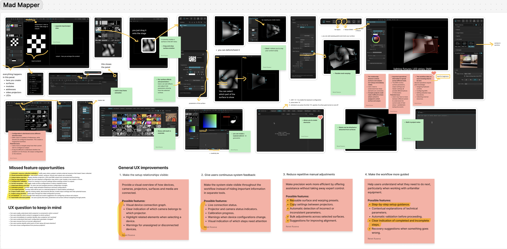

### 3. Resolume Arena

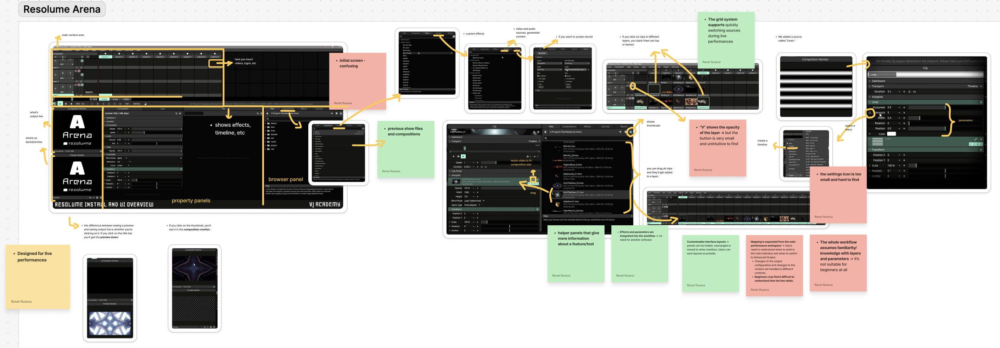

### 4. Heavy M

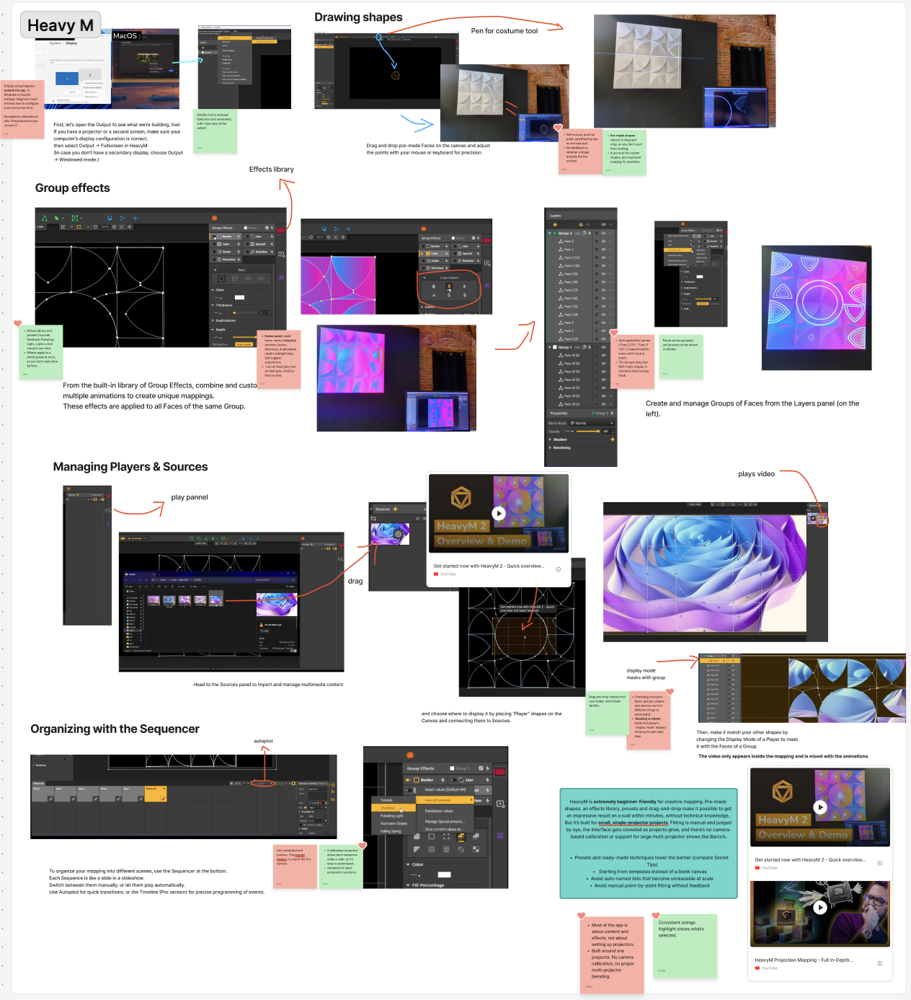

### 5. Touch designer

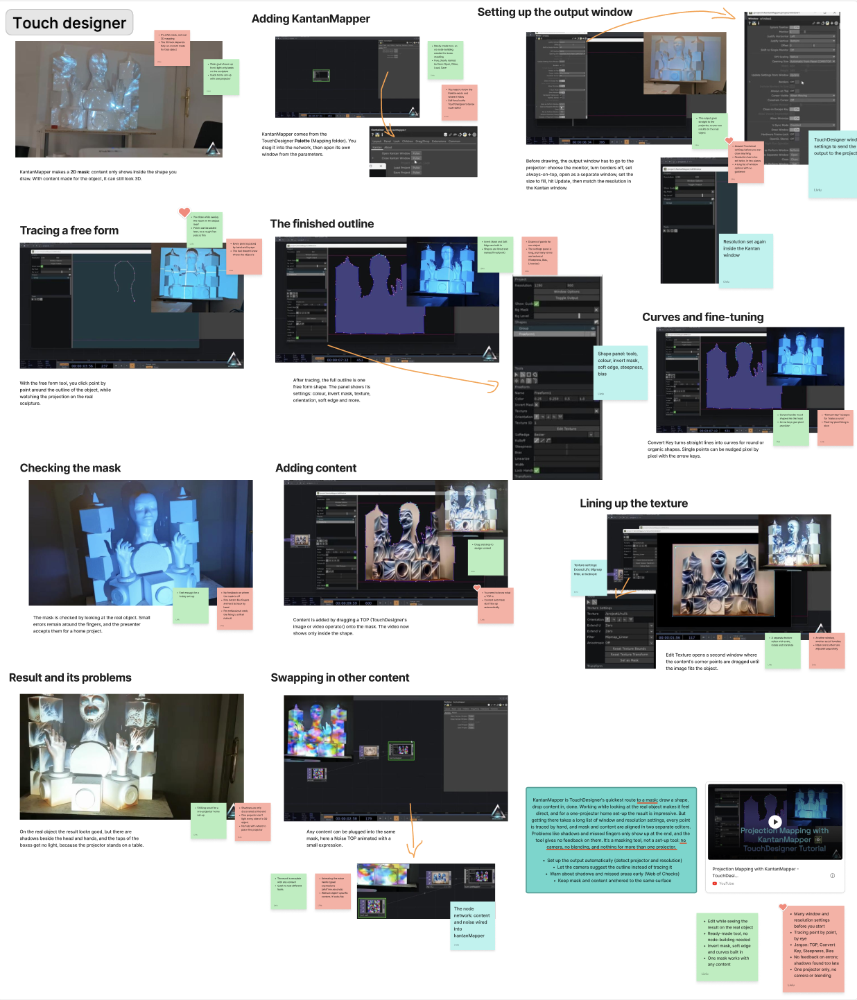

### 6. Isadora

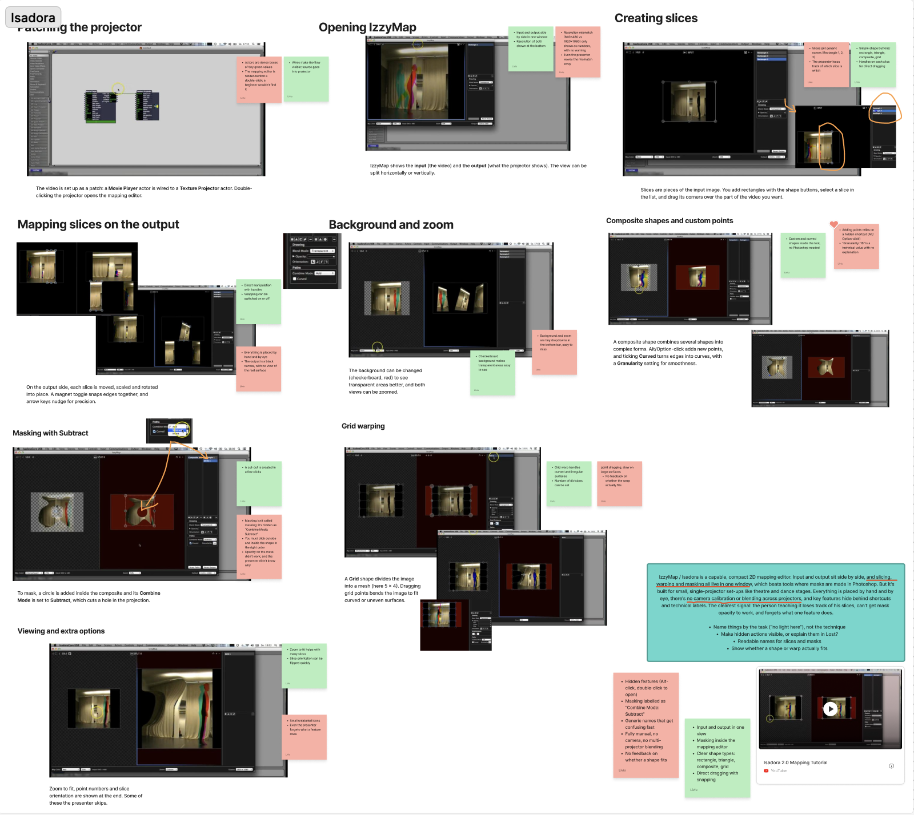

### 7. Millumin

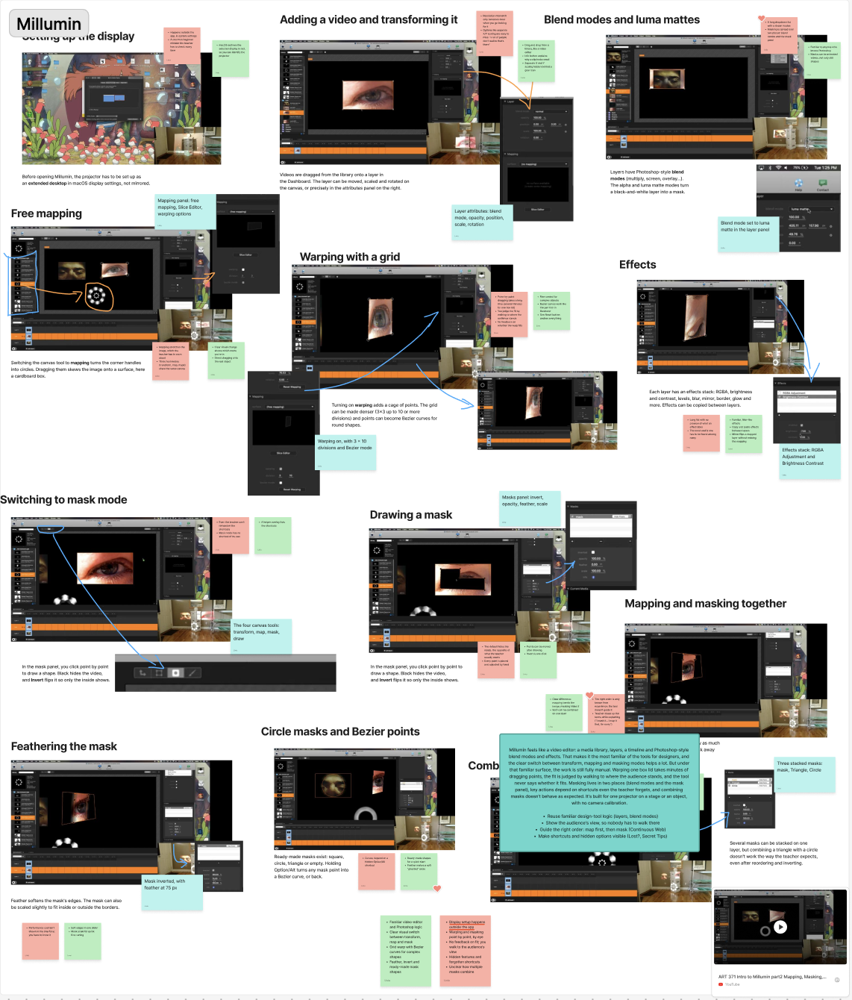

### 8. QLab

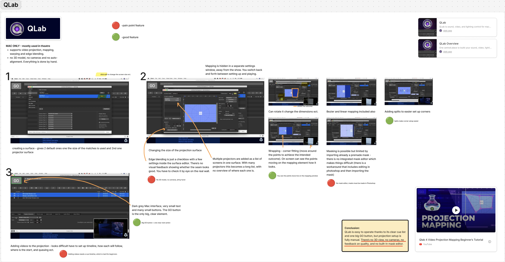

### 9. VPT 8

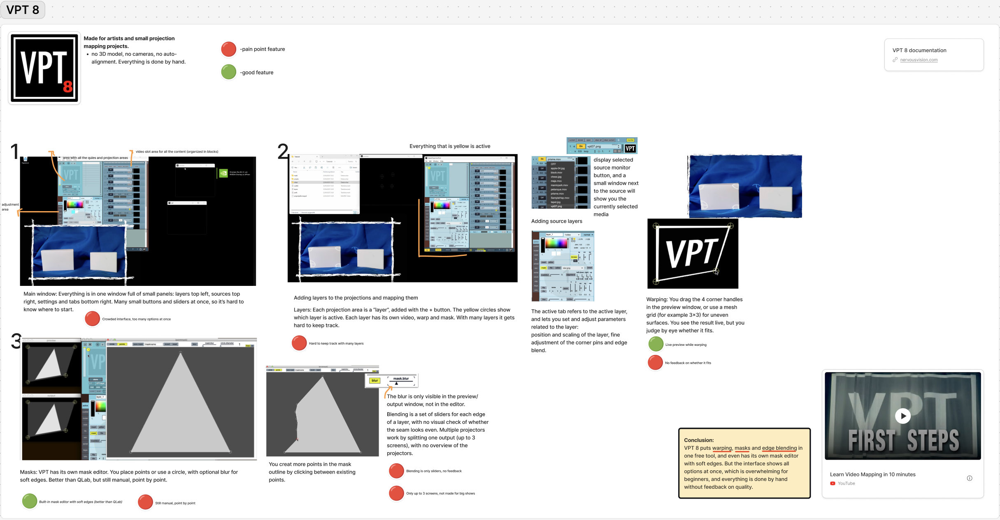

### 10. Map Club

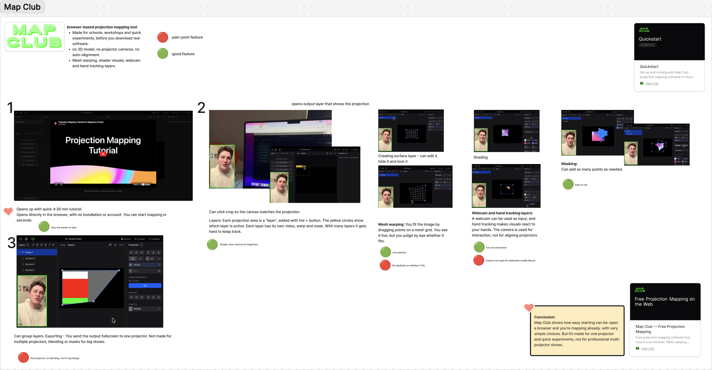

### 11. Splash

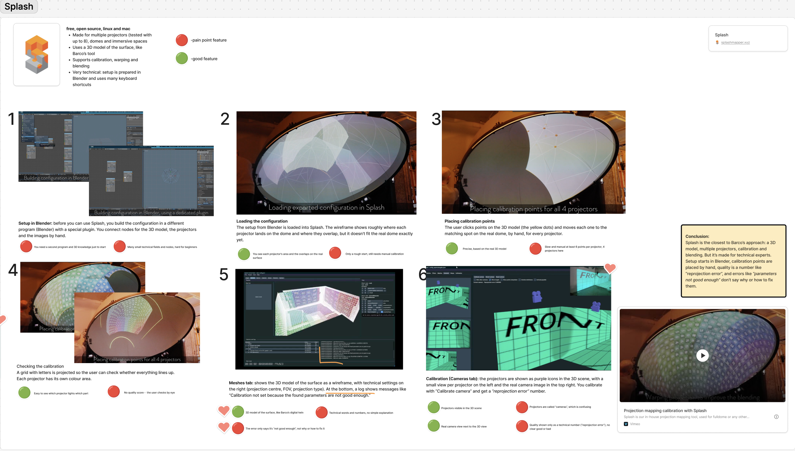

We hope this research can be used later when we begin to create lo-fi and mid-fi wireframes - we can learn from what these softwares get right, and what they get wrong.
