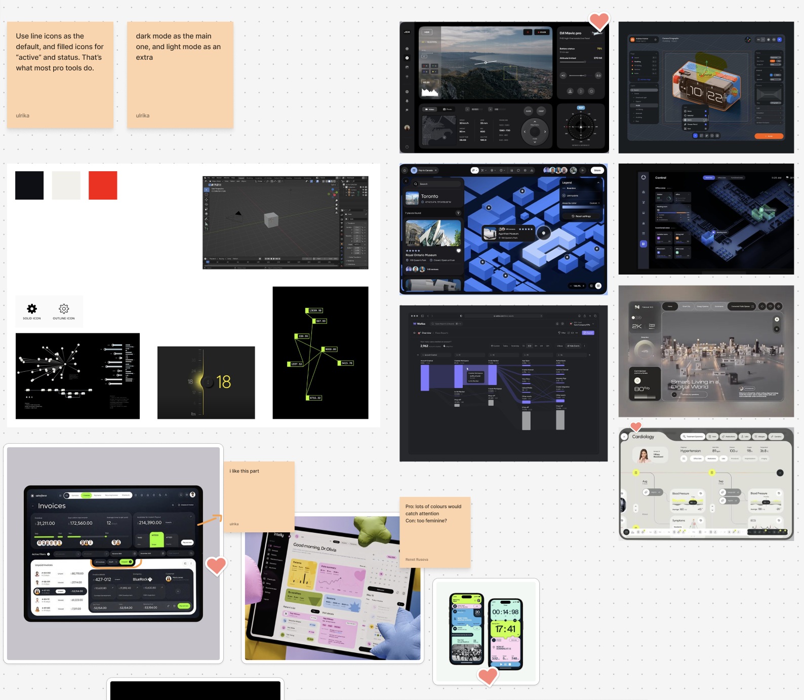
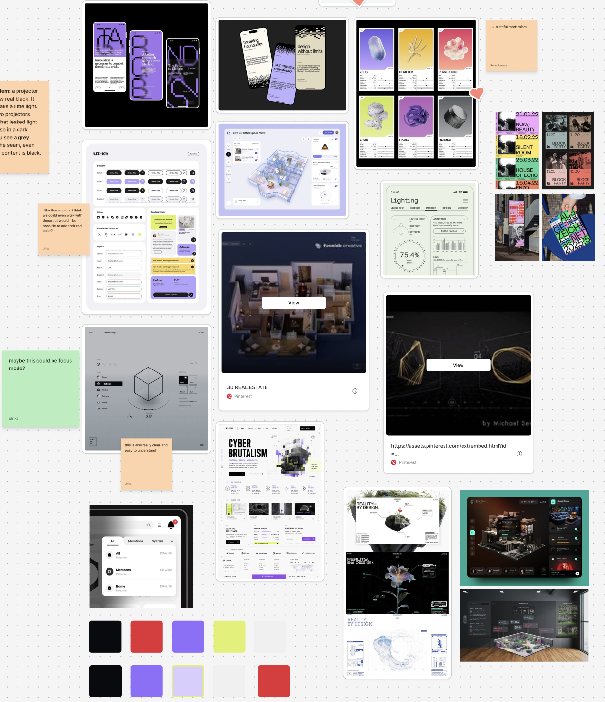
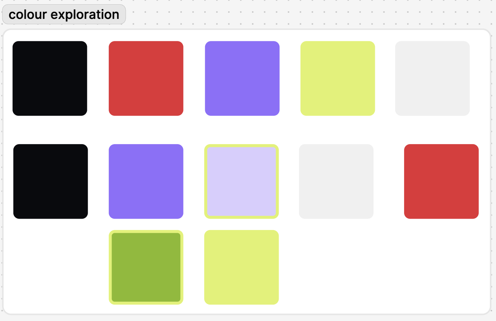
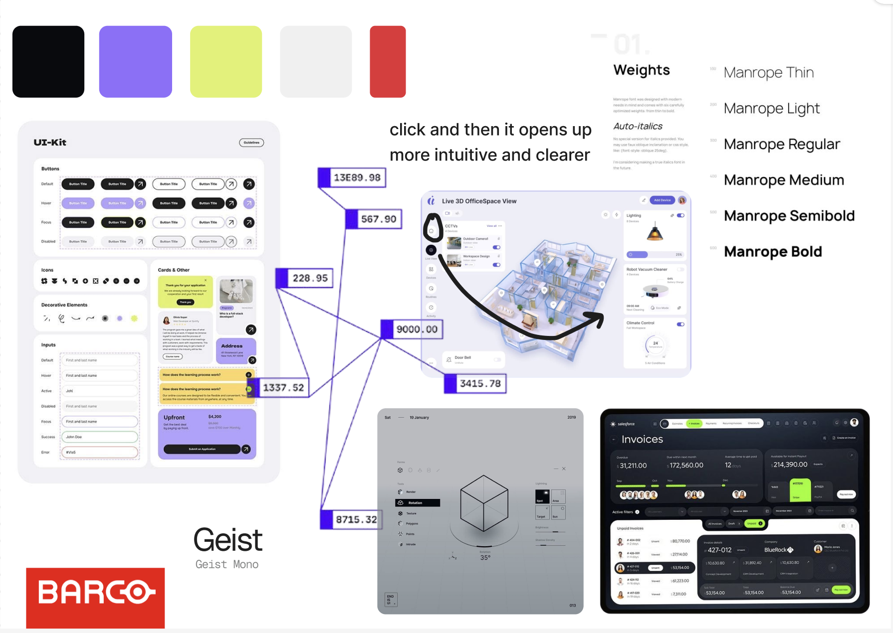
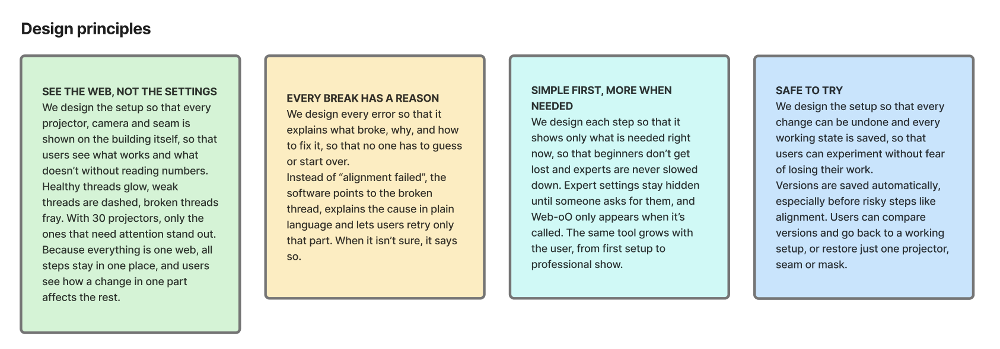

## Looking for inspiration

During the final days of the autumn break my team and I decided to begin gathering visual inspiration for how we want the interface to look like - colour palette, graphic elements, rounded corners, 3D environment, UX guidance or just overall visual design inspiration. This was the result of our material gathering:

Then we explored different possible colour combinations:

## Styleboard

After we explored different styles, graphic elements and colours, we created a styleboard:

### Why did we choose these colours?

We chose these colours, because they are:

- contrasting
- high energy
- beginner-friendly
- modern/trendy
- makes the software stand out

### Why did we choose this font? - Manrope (for the bodycopy):

We chose this font for the bodycopy, because it's:

- simple
- easy to read
- offers a lot of weights
- communicates friendliness and openness to the user

### Why we chose this font? - Geist Mono (for the numbers)

We chose this font for the numbers, because it:

- offers consistent alignment
- gives off a technical feeling
- is easy to scan through
- has a modern look to it

We wanted to go with rounded corners for our menus and panels, because they are more friendly, and offer a less intimidating look for beginners, or people with less experience.

## Design principles

After we discussed all of these design choices, we moved on to creating our design principles:

They are still subject to change, but this is their initial draft.
